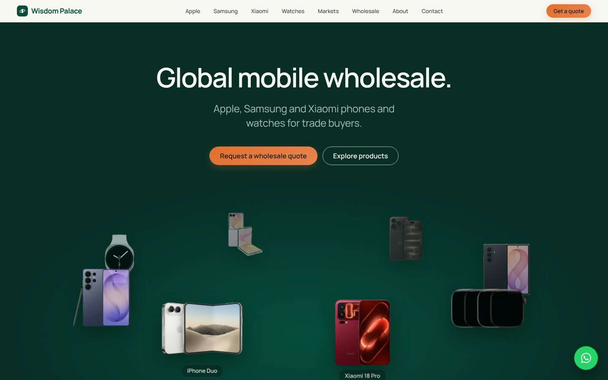
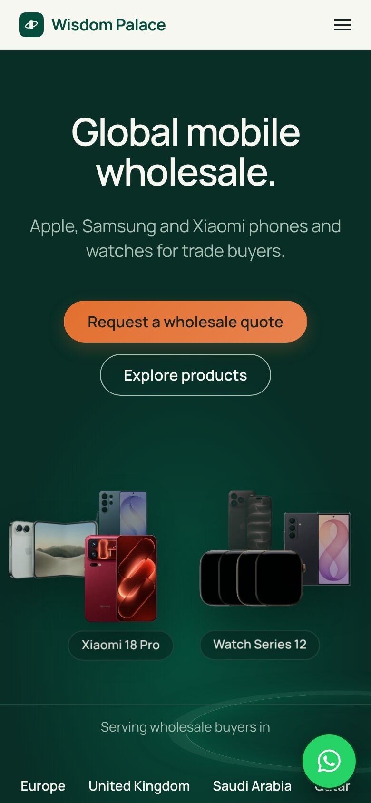

# Wisdom Palace — B2B Mobile Wholesale Website

> Live website for **Wisdom Palace**, a Dubai wholesaler of Apple, Samsung and Xiaomi phones and smartwatches.
> Designed and built by **[khaliqueuzaman](https://github.com/khaliqueuzaman)** · 2026

**▶ Live site:** https://wisdompalace.ae



---

## The brief

Wisdom Palace (Naif Road, Deira, since 2015) sells new phones and watches in bulk to retailers, resellers and distributors in the UAE, the GCC, the UK and Europe. The goal was an enquiry-driven B2B website, not a retail shop, that:

- presents the full Apple, Samsung and Xiaomi range professionally, with **no public prices**
- lets a buyer **build an order** (model, storage, colour, regional spec, quantity) instead of typing it out
- turns visitors into **wholesale quotation requests** and WhatsApp conversations
- feels like a premium, Apple-style brand: calm, fast and easy to read

## My role

End-to-end: brand direction, design system, information architecture, UX copy, front-end build, enquiry back end, hosting, domain, business email and launch.

## What I built

| Area | Details |
|---|---|
| **Design system** | Emerald and off-white palette with orange only for primary actions, Manrope variable type scale, design tokens, colour swatches for every model |
| **Catalogue** | 40+ product series: iPhone 13 to 18 Pro and iPhone Duo, Galaxy S23 to S26 FE, A57, Z Fold and Z Flip, Xiaomi 14 to 18, Apple Watch, Galaxy Watch, Xiaomi and Redmi watches |
| **Order builder** | Pick model, storage or case size, colour, regional spec and quantity; lines collect in a quote drawer and go to sales in one enquiry |
| **Official specs** | Manufacturer spec sheets for every model (Apple Support, Samsung Newsroom, mi.com), aligned in tabs per model |
| **Enquiry back end** | Three-step form (order, delivery, details) with server-side validation, rate limiting and a spam trap; sent through the Hostinger Mail API so it lands in the inbox |
| **SEO** | Clean URLs, sitemap, structured data, robots rules, Google Business Profile updated to match |
| **Legal** | Terms of business, privacy policy and cookie policy with consent banner |
| **Responsive** | Mobile-first layouts tested at 390px, tablet and 1440px |

## Screenshots

| Order builder | Official specifications |
|---|---|
|  |  |
| **Enquiry form** | **Mobile** |
|  |  |

## Tech

- [Astro](https://astro.build) static site, TypeScript, plain CSS with design tokens (no UI framework)
- Self-hosted Manrope Variable font, WebP product photos, lazy loading
- PHP enquiry endpoint (`public/api/enquiry.php`) using the Hostinger Mail API; the API key is stored on the server outside the web root and is not in this repository
- Hosted on **Hostinger** with CDN and SSL; business email on Hostinger Mail

## Repository contents

```
src/pages/        Home, brand and product pages, markets, contact, legal pages
src/components/   Header, order builder, quote drawer, specs, swatches, cards
src/data/         Catalogue, specifications, site content
src/styles/       Design tokens and styles
public/api/       Enquiry endpoint
public/images/    Product photos (WebP)
scripts/          Sitemap generator
docs/             Screenshots
```

## Run locally

```bash
npm install
npm run dev        # http://localhost:4321
npm run build      # production build into dist/
```

## Note

This repository is a **portfolio showcase**. No credentials or hosting secrets are included. "Wisdom Palace" belongs to the client; product names, photos and specifications belong to their manufacturers. The design and code are shared for viewing only — see [LICENSE](LICENSE).
