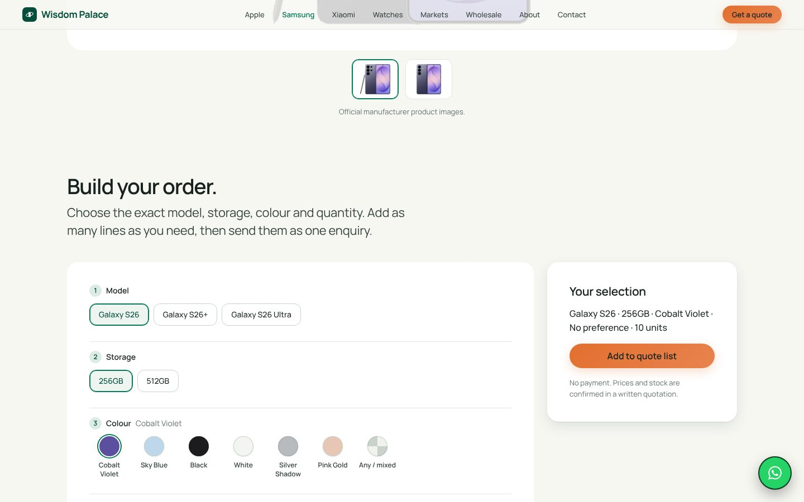
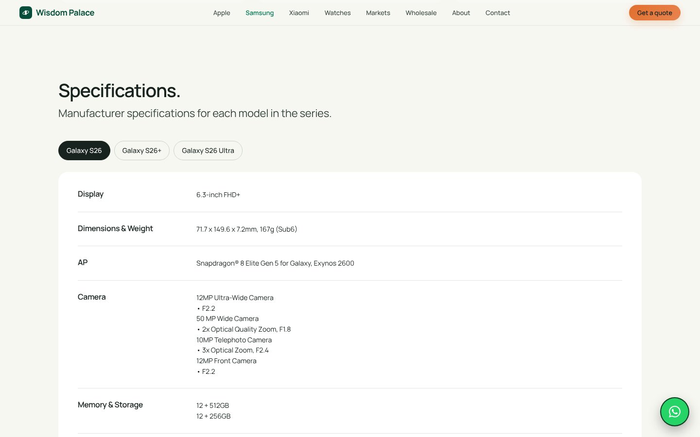
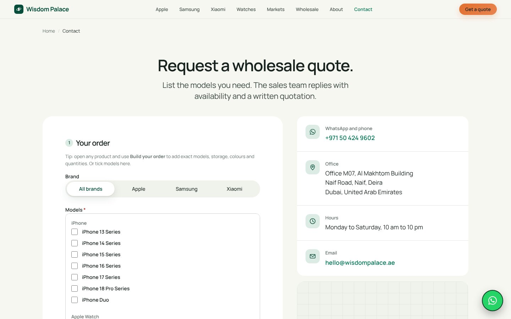

# Wisdom Palace — B2B mobile wholesale website

Live site: **[wisdompalace.ae](https://wisdompalace.ae)**

Website for Wisdom Palace, a Dubai wholesaler of Apple, Samsung and Xiaomi phones and smartwatches (Naif Road, Deira, since 2015). Trade buyers browse the range, build an order by model, storage, colour, regional spec and quantity, and send it to the sales team by email or WhatsApp.


## Highlights

- **Order builder and quote list**: pick model, storage, colour swatch, regional spec and quantity on any product page; lines collect in a quote drawer and go to the sales team in one enquiry.
- **Three-step enquiry form**: order, delivery (country, city or port, currency), contact details. Validated server-side, rate-limited, honeypot spam trap.
- **Official specifications**: every phone and watch carries the manufacturer's spec sheet (Apple Support, Samsung Newsroom, mi.com), with per-model tabs.
- **Email that lands in the inbox**: enquiries are sent through the Hostinger Mail API, so they are signed as the business mailbox. The API key lives in a config file outside the web root, never in this repository.
- **WhatsApp everywhere**: floating button and pre-filled order messages.
- **Fast and accessible**: static HTML, self-hosted variable font, WebP product photos, keyboard-friendly tabs and drawers, reduced-motion support.
- **SEO and legal**: sitemap, structured data, robots rules, terms of business, privacy and cookie policies.

| Product page and order builder | Official specs | Mobile |
|---|---|---|
|  |  |  |



## Tech stack

- [Astro](https://astro.build) static site, TypeScript, plain CSS with design tokens
- Manrope Variable via `@fontsource-variable/manrope`
- PHP endpoint (`public/api/enquiry.php`) for enquiries, Hostinger Mail API
- Hosted on Hostinger with CDN and SSL

## Project structure

```
src/
  pages/        Home, brand and product pages, markets, contact, legal pages
  components/   Header, order builder, quote drawer, specs, swatches, cards
  data/         catalog.ts (models, storage, colours), specs.json, content.ts
  lib/          site details, quote list logic
  styles/       global.css (design tokens at the top)
public/
  api/          enquiry.php
  images/       product photos (WebP)
scripts/
  sitemap.py    writes dist/sitemap.xml after a build
```

## Run locally

```bash
npm install
npm run dev        # http://localhost:4321
npm run build      # production build into dist/
python3 scripts/sitemap.py dist https://wisdompalace.ae
```

`PREVIEW=1` builds one `.html` file per page with the enquiry form in demonstration mode (nothing is sent), used for design reviews.

## Configuration

The enquiry endpoint reads `wp-config/enquiry.php` from the domain folder, **outside** `public_html`:

```php
<?php return ['mail_api_token' => '…', 'mailbox_id' => 'AC…'];
```

Without it, the endpoint falls back to the server's mail transport.

## Credits

Product photos and specifications belong to Apple, Samsung and Xiaomi and are shown to identify the products sold. Brand names are trademarks of their owners.

Code and design © Wisdom Palace. All rights reserved.
